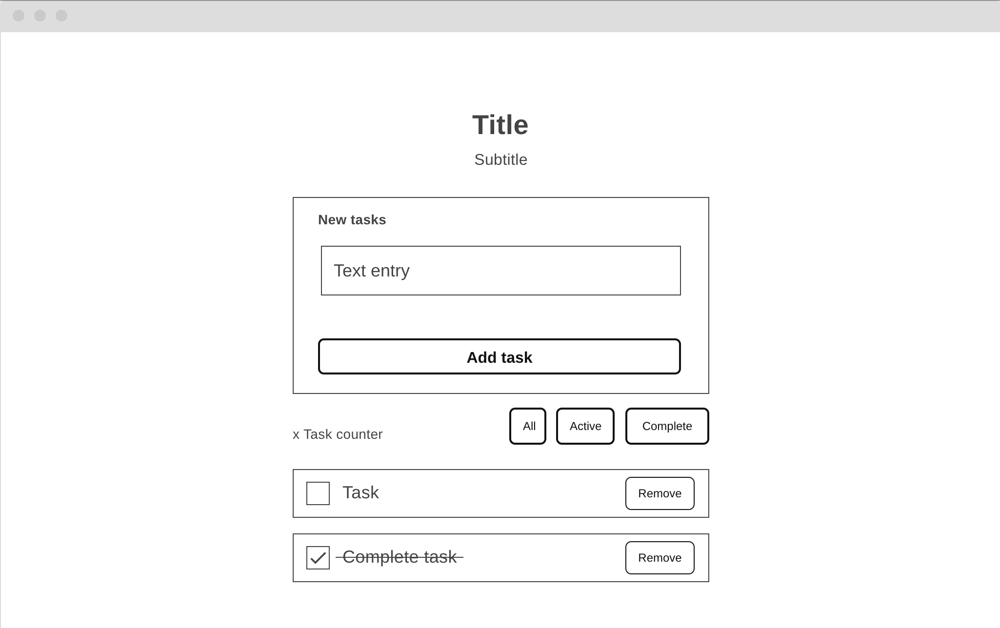
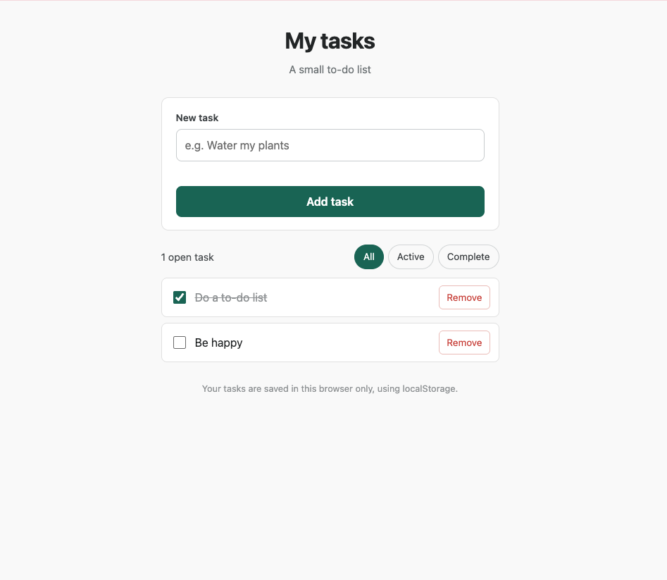

# web_dev_1_project_1
## Simple To-Do application

**Author(s):** Sofia Ade

## Project plan

### Project idea
This is a small, simple, single-page to-do list application, a project that probably a million of undergraduate students in computer science have done. The application can be run locally or visited on the GitHub page.


### Planned features
- Add a new task through a form, with validation for empty or too-short (< 2 characters) input
- Mark a task as completed and remove a task from the list
- when marking a task as "complete", confetti will fall from the top to the bottom of the screen
- Save items in the browser with localStorage, so that items remain after a page refresh
- Items can be sorted by "All", "Active", and "Complete"


### Wireframe



## Web links
- **Published application:**


## About the application

**[The simple To-do list]** is a web application that lets a user keep a simple to-do list in their browser. Tasks are added through a validated form, can be marked as completed or removed, and can be filtered to show all, active, or completed tasks. An open-task counter updates automatically, and the whole list is saved with 'localStorage', so it survives a page refresh.


## Technologies
- HTML5 - page structure (a form and a dynamically generated task list)
- CSS - minimalistic, card-based layout
- vanilla JavaScript - DOM scripting, from validation, event handling and element creation
- localStorage - saving created items in the browser so it persists visits


## How to use the application
1. Open published application, or alternatively open 'index.html' locally
2. Type a task into the "New task" field and click "Add task"
3. Click the checkbox next to a task to mark it completed, or click "Remove" to delete the task
4. Use the "All", "Active", "Completed" buttons to filter which tasks are shown. The open-task count updates automatically


## Running the application locally
1. Clone the repository to your computer
```bash
git clone https://github.com/s98ade/web_dev_1_project_1.git
```
2. Open the project folder
3. Open 'index.html' in a web browser (or use a live server extension in your IDE)

## Screenshots



## Known issues / limitations
- Tasks are only stored in the browser that was used to add tasks
- Tasks are not synced across browsers or devices
- Tasks can't be edited once it was added to the list (it has to be removed and re-entered)
- Deleted tasks are not moved to a temporary trash bin; when deleted, they're gone


## Self-assessment and learning reflection
**What did I succeed in?**
- I have tried to cover most of the courses material in this project, from creating objects, manipulating DOMs, using localStorage
- I have tried to follow the concept of "separation of concern" by dividing applications functionality and features into their own functions
- I tried to make sure the error clears when the input becomes valid and the field is refocused after adding a task 

**What was challenging?**
- finding a starting point and iterating over it (it becomes easily overwhelming)
- not becoming too reliant on AI and not giving up too fast and asking AI instead
- "patchwork code" (coping code snippets from different sources and praying it will work)

**What would I improve if I had more time?**
- add a feature where you can edit a task
- add support across multiple browsers

**What did I learn about html, css, javascripting and dom scripting?**
- besides learning JavaScript, the concept of DOM manipulation and how HTML parts can be generated through JS code, is failry new to me

**my self-assessed project grade:** 08/10 (since I didn't added the instruction video)


## Sources
**Confetti feature:** 
https://devlawrence.hashnode.dev/lets-build-a-confetti-effect-with-vanilla-javascript

https://dev.to/devlawrence/creating-a-confetti-effect-from-scratch-using-html-css-and-javascript-4poi

**General functionality of a to-do app:**
https://www.w3schools.com/js/js_project_todo.asp

https://webdesign.tutsplus.com/to-do-app-with-vanilla-javascript--cms-35258t

https://dev.to/saimanis/build-a-to-do-list-app-with-html-css-javascript-beginner-javascript-project-tutorial-2eaj

**Use of GenAI:**
AI has been used for the following tasks and purposes:

- creating a base structure for HTML and CSS
- giving guidance and explanation when stuck in development and suggesting improvements


